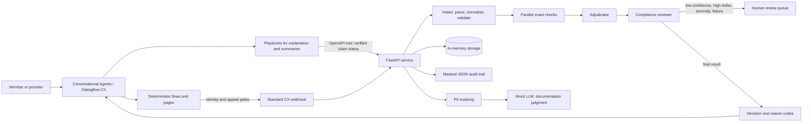

# Synthetic Claims Processing CX Prototype

A local-first, synthetic-only US healthcare claims-processing prototype for
demonstrating conversational design, deterministic adjudication, human review,
privacy guardrails, and reproducible evaluation. It is not a payer system and
does not make real coverage or clinical decisions.

> **Prototype, not HIPAA-certified. Synthetic data only. Do not enter real PHI.**

## What this prototype does

It separates the user-facing conversation from the claim decision service:

1. A Google Dialogflow CX / Conversational Agents design routes member and
   provider requests, enforces an identity flow, and explains backend results.
2. A Python/FastAPI service accepts synthetic 837-style JSON, performs exact
   rules, records a masked audit trail, and returns a 835/277-style outcome.

The backend runs in local mock mode without Google Cloud credentials. It uses
an in-memory repository and a stub LLM; the cloud integration is optional.

## Architecture



### Why flows, playbooks, tools, and a Python backend

- **Flows/pages** own identity verification, appeal confirmation, and escalation.
  Those steps are compliance-sensitive and should not rely on free-form
  generation. The mock requires both a synthetic member ID and date of birth
  before returning a status; it never echoes either value.
- **Playbooks** are intended for natural-language request handling, plain
  language denial explanations, and appeal/document summaries. They may only
  explain backend-provided reason codes and benefit values; they must not invent
  a coverage decision or give legal/medical advice.
- **OpenAPI tools and a standard webhook** connect CX to the service. The
  identity-gated `/cx/tools/*` routes validate member ownership before
  returning status. The standard webhook follows the CX `WebhookRequest` /
  `WebhookResponse` JSON contract.
- **FastAPI** keeps adjudication, audit, storage, and the same webhook contract
  runnable locally and testable without a live agent or cloud project.

The versioned CX artifacts are a [design blueprint](cx_agent/agent-blueprint.yaml),
[OpenAPI schema](cx_agent/openapi.yaml), and
[scripted conversations](cx_agent/conversation-cases.json). The blueprint is
explicitly **not** a Google-generated export package. A real agent export
requires an existing configured agent in a GCP project.

### Exact rules versus LLM judgment

Eligibility dates, supported-code membership, duplicate detection, authorization
requirements, cost sharing, and reason-code ranking are deterministic. These
rules are testable and must not vary with a language model. The LLM abstraction
is used only for free-text documentation consistency judgment (and provides
language-task seams for explanations and appeal summaries). Its input is masked
first. A low-confidence result is pended for a human rather than used to
automatically deny or pay a claim.

The local `StubLLMClient` is not a real LLM and makes no network calls. The
evaluation comparison therefore measures only the stub's configured
low-confidence review routing; it does not demonstrate that a production LLM
improves adjudication.

## Synthetic data and code licensing

All fixture identities, identifiers, providers, plans, and claims are
synthetic. The generator is seeded and includes duplicate claims, expired
coverage, out-of-network providers, missing prior authorization,
diagnosis/procedure mismatch, unbundling, coordination of benefits, missing
fields, and low-confidence documentation.

The sample uses a short ICD-10-CM subset and HCPCS Level II examples. Procedure
consistency uses only local codes `ILL-PROC-001` and `ILL-PROC-002`. These are
illustrative, invented procedure codes—not CPT codes. The repository does not
bundle the AMA CPT code set. Code-to-service mappings and benefit math are
educational toy rules, not clinical or payer policy.

The 128-case labeled evaluation set is generated at
[`data/synthetic/evaluation_claims.json`](data/synthetic/evaluation_claims.json).
Expected outcomes/reasons are specified by the generator independently of the
adjudication implementation.

## Quick start (Windows PowerShell)

Python 3.11 or newer is required. From the repository directory:

```powershell
py -3.11 -m venv .venv
.\.venv\Scripts\Activate.ps1
python -m pip install -e ".[dev]"
python -m pytest tests --cov=claims_processing_cx --cov-report=term-missing --cov-report=json:evals/results/coverage.json
```

Run the local CX webhook conversation:

```powershell
python -m claims_processing_cx.conversation
```

Start the API:

```powershell
python -m uvicorn claims_processing_cx.api:app --host 127.0.0.1 --port 8000
```

The mock API exposes:

| Route | Purpose |
|---|---|
| `POST /adjudicate` | Validate and adjudicate a synthetic claim JSON body |
| `GET /claims/{claim_id}/status` | Read a local adjudication result |
| `POST /appeals` | Accept synthetic appeal intake |
| `GET /review-queue` | List `PENDED_FOR_REVIEW` decisions |
| `POST /webhook` | Dialogflow CX standard webhook contract |
| `POST /cx/tools/claim-status` | Identity-gated minimum-necessary claim status |
| `POST /cx/tools/appeals` | Identity-gated appeal intake |
| `GET /health` | Local service readiness |

`CX_WEBHOOK_TOKEN` is optional in local mode. If configured, webhook and CX tool
requests require `Authorization: Bearer <token>`. This shared-token mock is not
a complete production identity or authorization design.

## Reproduce the evaluation

The evaluation is generated and run locally; it does not contact Google Cloud or
use a paid LLM:

```powershell
python -m evals.generate_dataset
python -m evals.run_eval
```

The runner writes JSON and Markdown to
[`evals/results/`](evals/results/). It measures decision accuracy, per-class
precision/recall/F1, confusion matrix, exact reason-code accuracy, agreement
across three runs, phase latency, mock token usage, rules-only comparison,
paired proxy disagreement, and scripted local conversation checks. Any
misclassified cases and likely causes are listed in the JSON/Markdown report;
the current generated result has no mismatches.

### Current measured result

These are values read from the saved
[`evaluation report`](evals/results/evaluation.md), generated by
`python -m evals.run_eval` on the synthetic dataset (seed `20261031`):

| Measure | Saved result |
|---|---:|
| Labeled claims | 128 (32 per outcome class) |
| Decision accuracy | 1.0000 (128/128) |
| Exact reason-code accuracy | 1.0000 (128/128) |
| Exact consistency across 3 runs | 1.0000 (128/128) |
| Rules-only accuracy | 0.9375 (120/128) |
| Mock-assisted accuracy | 1.0000 (128/128) |
| Local dialogue intent/escalation/no-leakage/grounding | 1.0000 each |
| Paired name/ZIP decision disagreement | 0.0000 (0/30 pairs) |
| Branch-aware test coverage ([saved pytest-cov report](evals/results/coverage.json)) | 86.41% |

The 8 mock-assisted cases that differ from rules-only are low-confidence
documentation cases routed to human review. They are labeled as review cases in
this synthetic test. The model stub makes no tokens, so the saved token count is
zero and a paid-model cost estimate is not applicable.

The reported conversation values come from six scripted dialogues and a local
deterministic keyword router using the same API contracts—not from Dialogflow
CX NLU, a live playbook, or a deployed Google agent. The fairness value is a
small regression probe on 30 paired cases, not a population fairness estimate.
The measured phase timings in the report are local-run observations, not
throughput or service-level claims. Review the report for the confusion matrix,
latency samples, baseline changes, and limitations.

## Demo walkthrough

1. Start the API or run the local simulator.
2. The simulator adjudicates a synthetic expired-coverage claim.
3. It submits a Dialogflow-shaped webhook request using fixture identity fields.
4. The response reports the backend status and `CO-27`, without echoing the
   member ID, date of birth, or claim ID.

Example:

```text
Synthetic user: Check my claim status.
Synthetic agent: Identity verified using fixture values (not displayed).
Synthetic agent: Claim status: DENIED. Backend reason codes: CO-27.
```

Use the evaluation commands above to see the full decision and conversation
results.

## Google Cloud setup

The current Google documentation uses **Dialogflow CX** for the API/product
documentation and **Conversational Agents console** for the newer UI. The
console is compatible with existing Dialogflow CX agents and uses the same
Dialogflow API. The documented native export formats are `BLOB` and
`JSON_PACKAGE`; this project uses the latter. The restore API replaces the
target agent's current resources.

See [`docs/cx-deployment.md`](docs/cx-deployment.md) for console setup, export,
and restore commands. Export/import scripts use the optional
`google-cloud-dialogflow-cx` package and Application Default Credentials.
`CX_CONFIRM_RESTORE` must exactly match `CX_TARGET_AGENT` to reduce accidental
restores. No credentials or live GCP resources are included in this repository.

Google references checked:

- [Conversational Agents console](https://cloud.google.com/dialogflow/cx/docs/concept/console-conversational-agents)
- [Playbooks](https://cloud.google.com/dialogflow/cx/docs/concept/playbook)
- [Playbook tools](https://cloud.google.com/dialogflow/cx/docs/concept/playbook/tool)
- [Webhooks](https://cloud.google.com/dialogflow/cx/docs/concept/webhook)
- [Agent export](https://cloud.google.com/dialogflow/cx/docs/reference/rest/v3/projects.locations.agents/export)
- [Agent restore](https://cloud.google.com/dialogflow/cx/docs/reference/rest/v3/projects.locations.agents/restore)
- [Python client library](https://cloud.google.com/python/docs/reference/dialogflow-cx/latest)

## Engineering commands

The Makefile targets are `install`, `test`, `eval`, `demo`, and `serve`.
GitHub Actions runs Ruff, mypy, pytest with coverage, and the evaluation in
mock mode. To build/run the local container:

```powershell
docker build -t claims-processing-cx .
docker run --rm -p 8000:8000 claims-processing-cx
```

## Limitations and future work

- No live Dialogflow CX agent was provisioned, trained, published, or tested
  against the Google runtime. The YAML is a blueprint, not an importable agent
  package. Create/configure an agent in a GCP project before exporting a native
  JSON package.
- The evaluation is synthetic, intentionally balanced, and deterministic. Its
  perfect label match is not evidence of real-world clinical, payment, or
  operational performance.
- The code lists, medical-necessity mapping, benefit schedule, duplicate
  detection, and fraud/waste/abuse checks are small illustrative rules.
- Storage is in-memory; Postgres/Firestore, workload identity, API gateway
  authorization, durable audit retention, and production monitoring are future
  work.
- The local simulator does not exercise Google CX's generative model or actual
  intent recognition. Google-side model context, retention, and redaction must
  be validated separately before any sensitive data use.
- No production identity proofing, appeal adjudication, document upload,
  provider network, payer eligibility, prior authorization, COB, or medical
  policy integration is implemented.
- This is not HIPAA-certified. A real deployment requires the additional
  privacy, security, cloud contracting, and oversight work in
  [`docs/responsible-ai.md`](docs/responsible-ai.md).
